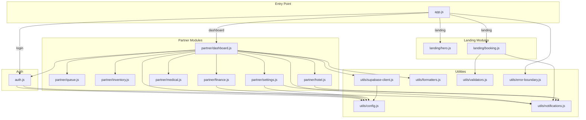

# FUFU Partner – Setup Guide

## Prerequisites

- **Node.js** ≥ 18.x
- **npm** ≥ 9.x
- **Supabase account** with a configured project

## Quick Start

```bash
# 1. Clone the repository
git clone https://github.com/Kittencode-co-ltd/FUFU_partner.git
cd FUFU_partner

# 2. Install backend dependencies
npm install

# 3. Configure environment
cp .env.example .env
# Edit .env with your Supabase credentials

# 4. Start the API server
node api.js
# Server runs on http://localhost:3000

# 5. Open in browser
# Landing:   http://localhost:3000/index.html
# Login:     http://localhost:3000/login.html
# Dashboard: http://localhost:3000/dashboard.html (requires auth)
```

## Project Structure

```
FUFU_partner/
├── index.html              # PUBLIC: Landing page for pet owners
├── login.html              # PARTNER: Login + store selection
├── dashboard.html          # PARTNER: Protected dashboard (all pages)
├── register.html           # PARTNER: Registration (unchanged)
├── api.js                  # Backend: Express.js + Supabase proxy
├── package.json            # Node.js dependencies
├── .env                    # Supabase credentials (not in git)
├── .env.example            # Template for .env
├── .gitignore
├── Dockerfile
│
├── css/                    # Modular CSS
│   ├── base.css            # Global resets, CSS variables, typography
│   ├── landing.css         # Landing page: navbar, hero, AI section
│   ├── auth.css            # Login page: orbs, cards, forms
│   ├── dashboard.css       # Dashboard: sidebar, topbar, stats, charts
│   └── components.css      # Shared: cards, badges, modals, toasts
│
├── js/                     # ES6 Modules
│   ├── app.js              # Entry point: auto-detects page, boots modules
│   ├── auth.js             # Login, logout, auth guard, store selection
│   │
│   ├── landing/            # Public Flow modules
│   │   ├── hero.js         # AOS init, navbar scroll, hamburger menu
│   │   └── booking.js      # Booking form handler (placeholder)
│   │
│   ├── partner/            # Partner Flow modules
│   │   ├── dashboard.js    # Sidebar, navigation, KPIs, demo data
│   │   ├── queue.js        # Queue preview + full queue table
│   │   ├── inventory.js    # Product/service grid
│   │   ├── finance.js      # Income stats, transactions, commission
│   │   ├── medical.js      # Medical records (vet-only)
│   │   ├── hotel.js        # Room grid (hotel/service)
│   │   └── settings.js     # Store settings, Supabase config, geolocation
│   │
│   └── utils/              # Shared utility modules
│       ├── config.js       # API_BASE, STORAGE_KEYS, constants
│       ├── supabase-client.js  # Direct Supabase REST + backend API helper
│       ├── formatters.js   # Thai date, Baht currency, phone formatters
│       ├── validators.js   # Email, password, phone, XSS sanitization
│       ├── notifications.js # showToast() with type-based icons
│       └── error-boundary.js # Error wrapper, loading skeletons, empty states
│
└── docs/
    ├── SETUP.md            # This file
    └── SUPABASE-SCHEMA.md  # Database schema reference
```

## Module Dependency Diagram



## CSS Loading Order

| Page | CSS Files |
|------|-----------|
| `index.html` | `base.css` → `landing.css` |
| `login.html` | `base.css` → `auth.css` → `components.css` |
| `dashboard.html` | `base.css` → `dashboard.css` → `components.css` |

## Auth Flow

```
login.html → doLogin() → Backend API /api/auth
    ↓ success
renderStoreSelection() → selectStore()
    ↓ save token/role/store to localStorage
dashboard.html → requireAuth() → checks token
    ↓ valid
initDashboard() → renderSidebar() + renderDashboard()
```

Auth guard supports redirect: if an unauthenticated user accesses `dashboard.html`,
they are redirected to `login.html?redirect=dashboard.html` and returned after login.

## Backup Checklist

- [ ] `.env` file backed up separately (never committed to git)
- [ ] Supabase project URL and anon key documented securely
- [ ] Database schema exported from Supabase dashboard
- [ ] `api.js` backend tested with health check endpoint
- [ ] All localStorage keys documented in `js/utils/config.js`
